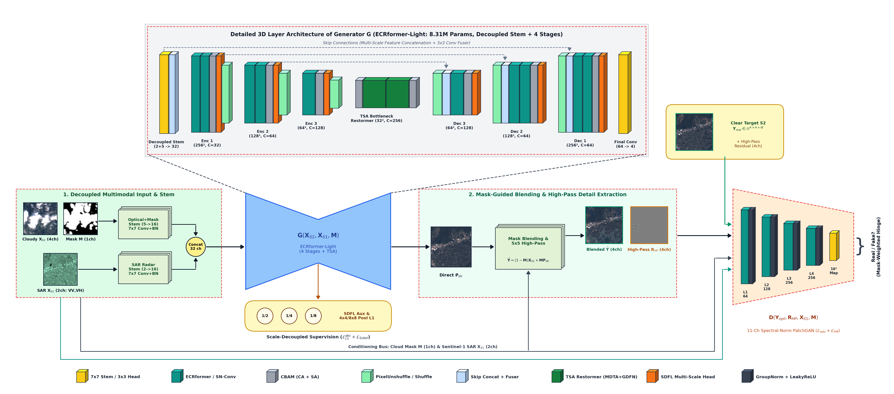
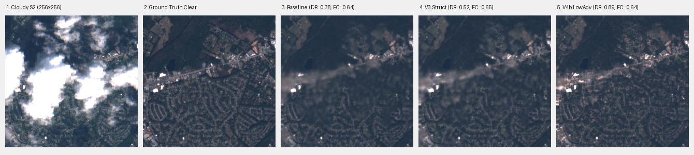
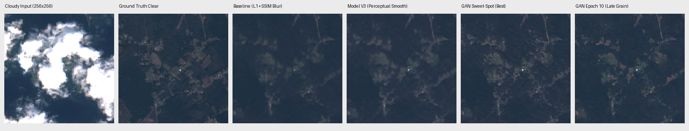
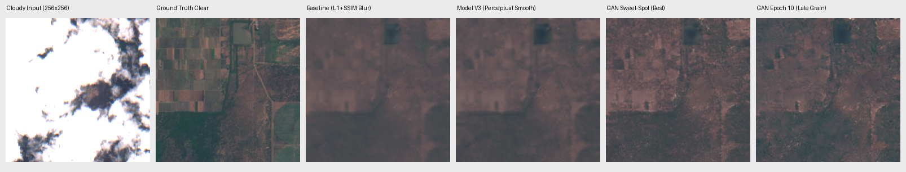
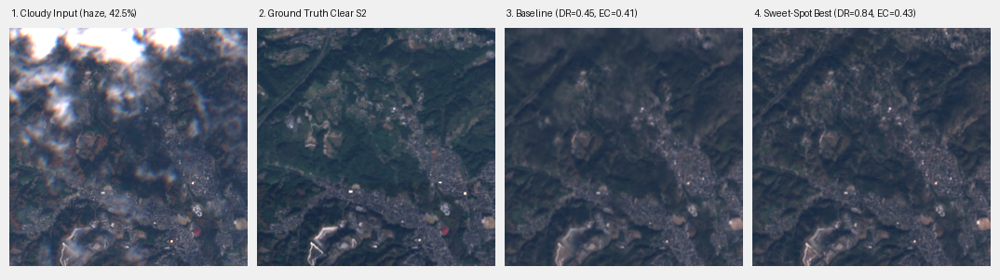
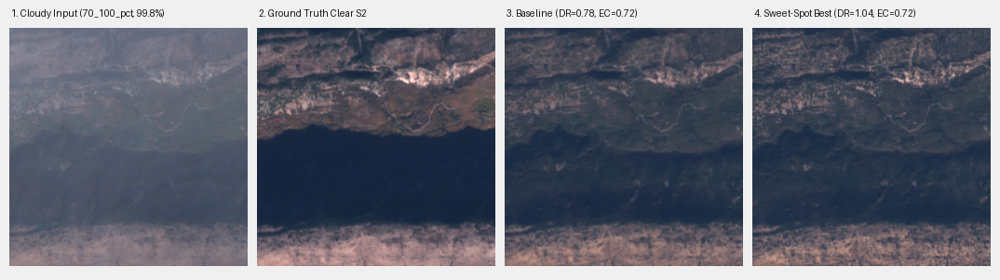

<div align="center">

  <h2><b> ECRformer: SAR-Guided Optical Cloud Removal with Conditional PatchGAN </b></h2>

  <p><b>Enhanced with High-Frequency Structural Detail, Soft-Mask Blending & Scale-Decoupled Supervision</b></p>

  <p>
    <a href="https://huggingface.co/vyyyyyyy/ecrformer-satellite-cloud-removal"><b>🤗 Hugging Face Model Weights</b></a>
  </p>

  

  <p><i>Figure: End-to-End Multimodal Cloud Removal Pipeline & Two-Tier Training Architecture.</i></p>

</div>

---

##  Overview: Solving the "Over-Smoothing" Trap

In optical-SAR cloud removal, when dense or opaque clouds block optical reflectance, models trained purely with pixel-wise $L_1$ and SSIM losses regress to the *conditional mean*. This results in **washed-out, blurry gray smudges** under clouds, erasing roads, fields, and waterlines (retaining only 23%–38% of high-frequency energy).

This repository contains the **Enhanced ECRformer**, introducing:
1. **Spectral-Normalized Conditional PatchGAN Discriminator:** Evaluates local $70\times 70$ patches conditioned on Sentinel-1 SAR and cloud masks, penalizing blurry smudges and enforcing authentic spatial textures.
2. **Scale-Decoupled $L_1$ Supervision:** Supervises low-frequency color and regional albedo using $4\times 4$ and $8\times 8$ pooled $L_1$, eliminating the double-penalty on sub-pixel shifted SAR edges while anchoring PSNR at $\approx 30\text{ dB}$.
3. **Multiscale Perceptual & Gradient Matching:** Incorporates VGG perceptual loss and multi-scale Sobel edge correlation to align reconstructed boundaries with real Sentinel-1 radar backscatter.

---

##  Repository Structure

```text
ecrformer/
├── backend/                  # Core PyTorch AI research, models, and training pipelines
│   ├── models/               # ECRformer-Lite, adapted dual-stream architecture & modules
│   ├── losses/               # Scale-Decoupled L1, PatchGAN, SDFL, and Perceptual losses
│   ├── checkpoints/          # Sweet-spot best model weights (~34.3 MB)
│   ├── data/                 # SEN12MS-CR dataset loaders and cache processors
│   └── assets/               # Architecture diagrams, visual evaluation strips, and charts
│
└── frontend/                 # Interactive Next.js web application
    ├── src/app/              # Next.js App Router, layout, and user interface
    └── public/               # Web assets, icons, and vector graphics
```

---


##  Sweet-Spot Best Model

The optimal checkpoint was captured at the adversarial sweet spot before late-epoch discriminator over-pressure, providing maximum structural sharpness without synthetic grain:

- **Checkpoint File:** [`backend/checkpoints/ecrformer_sweetspot_best/best_model.pth`](backend/checkpoints/ecrformer_sweetspot_best/best_model.pth) (~34.3 MB)
- **Metadata:** [`backend/checkpoints/ecrformer_sweetspot_best/model_metadata.json`](backend/checkpoints/ecrformer_sweetspot_best/model_metadata.json)
- **Parameters:** 8.31M total checkpoint parameters (active generator has **3.62M parameters**; supports $128\times 128$ and native $256\times 256$)

---

##  Comprehensive Cloud Strata Benchmark

Evaluated over **160 validation scenes** across 4 distinct atmospheric regimes at full native $256\times 256$ resolution on SEN12MS-CR:

| Atmospheric Regime | Evaluation Pool | Model | PSNR (Under Cloud) | PSNR (Full Scene) | Detail Ratio (Sharpness) | Edge Correlation (`grad_corr`) | Photometric MAE |
| :--- | :---: | :--- | :---: | :---: | :---: | :---: | :---: |
| **~10% Cloud** *(Sparse)* | 117 patches | Baseline (50 ep)<br>**Sweet-Spot Best** | 32.55 dB<br>**32.23 dB** | 33.17 dB<br>**33.13 dB** | 0.472 *(Blurry)*<br>**0.907** *(+92%)* | **0.425**<br>0.414 | 0.0183<br>**0.0191** |
| **~40% Cloud** *(Moderate)* | 187 patches | Baseline (50 ep)<br>**Sweet-Spot Best** | 33.24 dB<br>**32.09 dB** | 34.25 dB<br>**33.31 dB** | 0.448 *(Blurry)*<br>**0.907** *(+102%)* | **0.478**<br>0.476 | 0.0153<br>**0.0168** |
| **Haze Cloud** *(Semi-Transparent)* | 283 patches | Baseline (50 ep)<br>**Sweet-Spot Best** | 32.57 dB<br>**31.63 dB** | 33.47 dB<br>**32.80 dB** | 0.387 *(Heavy blur)*<br>**0.902** *(+133%)* | 0.393<br>**0.406** *(+3.3%)* | 0.0162<br>**0.0175** |
| **70%–100% Cloud** *(Dense Overcast)*| 370 patches | Baseline (50 ep)<br>**Sweet-Spot Best** | 30.37 dB<br>**30.02 dB** | 30.34 dB<br>**29.98 dB** | 0.632 *(Smudged)*<br>**0.931** *(+47%)* | **0.587**<br>0.573 | 0.0208<br>**0.0217** |

---

##  Visual Results Across Cloud Conditions ($256\times 256$ Resolution)

### 1. Urban Highway & Road Grid (Patch 420)
*Cloudy Input $\rightarrow$ Ground Truth $\rightarrow$ Baseline (Blur) $\rightarrow$ Model V3 $\rightarrow$ Sweet-Spot Best*


### 2. Rural Farms & Connecting Road Network (Patch 350)
*Cutting through clouds over agricultural valley*


### 3. Circular Pivot Irrigation & Water Reservoir (Patch 725)
*Accurately reconstructing irrigation geometries and shoreline contours*


### 4. Semi-Transparent Haze Dehazing
*Recovering hillside villages obscured by dense atmospheric veil*


### 5. 99.8% Opaque Overcast Mountain Canyon
*Traces winding riverbed and cliff outlines beneath dense cloud*


---

##  Quickstart Inference

```python
import torch
from backend.models.ecrformer_adapted import ECRformerAdaptedModel

# 1. Instantiate model
model = ECRformerAdaptedModel(
    features_start=32,
    num_blocks=[2, 2, 1, 1],
    num_refine=0,
    bottle_neck="tsa",
    cbam="1ca2+1sa2",
    mask_blend=True,
    head_init="mean_prior"
)

# 2. Load sweet-spot weights
ckpt = torch.load("backend/checkpoints/ecrformer_sweetspot_best/best_model.pth", map_location="cpu", weights_only=False)
model.load_state_dict(ckpt["ema_state_dict"])
model.eval()

# 3. Predict (Supports 128x128 or native 256x256)
# s2_cloudy: [B, 4, H, W] in [0, 1] reflectance
# s1_sar:    [B, 2, H, W] in paper_exact norm: VV [-25,0] -> [0,1], VH [-35,0] -> [0,1]
# mask:      [B, 1, H, W] soft cloud mask in [0, 1]
with torch.no_grad():
    pred_blended, pred_direct, _ = model(s2_cloudy, s1_sar, mask)
```

---

##  Training with Conditional PatchGAN

To train or reproduce the fine-tuning run from the `backend/` directory:

```bash
cd backend
python train_ecrformer_v4_gan.py \
  --epochs 10 \
  --max_steps_per_epoch 1600 \
  --d_warmup_steps 200 \
  --micro_batch_size 4 \
  --accum_steps 4 \
  --lr_g 1.2e-4 \
  --lr_d 2.5e-4 \
  --sar_lr_mult 2.0 \
  --w_adv 0.015 \
  --w_fm 0.15 \
  --lambda_struct 1.25 \
  --dr_weight 0.15 \
  --ema_decay 0.990 \
  --sar_norm paper_exact \
  --crop_size 128 \
  --run_name ecrformer_v4b_gan_lowadv
```

---

##  Original Reference & Citation

```bibtex
@article{zhang2026ecrformer,
    title     = {{ECRformer: An efficient cloud removal Transformer with semantic-decoupled learning for multimodal satellite imagery}},
    author    = {Zhang, Zaiyan and Li, Jie and Liang, Yuanqi and Yan, Jining and Xiao, Yi and Su, Xin and Yuan, Qiangqiang},
    journal   = {ISPRS Journal of Photogrammetry and Remote Sensing},
    volume    = {237},
    pages     = {323-338},
    year      = {2026},
    publisher = {Elsevier},
    doi       = {10.1016/j.isprsjprs.2026.04.009}
}
```
