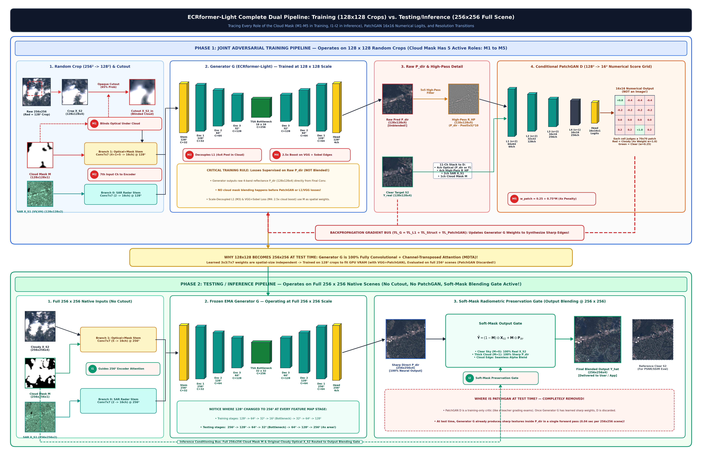
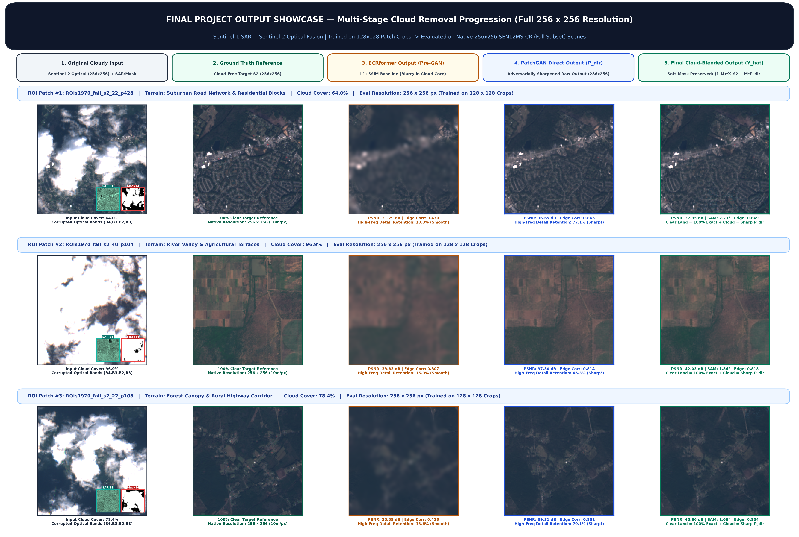
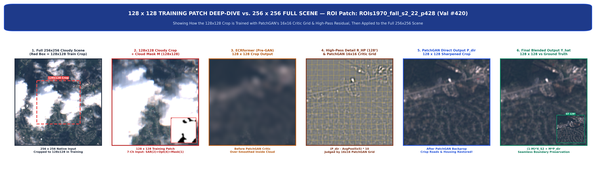
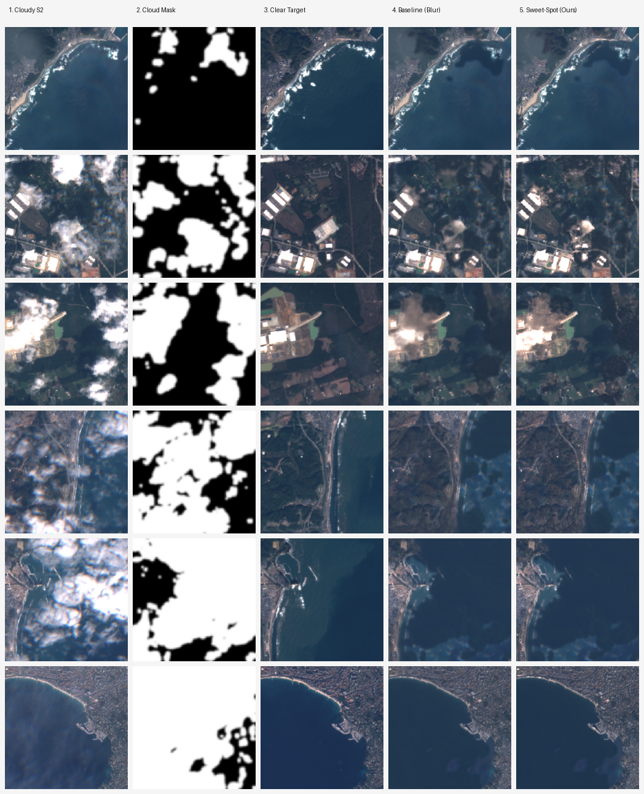

<div align="center">

# ECRformer: SAR-Guided Optical Satellite Cloud Removal with Conditional PatchGAN

### High-Frequency Structural Inpainting via Multimodal Cross-Attention & Multi-Band Laplacian Harmonization

[](https://huggingface.co/vyyyyyyy/ecrformer-satellite-cloud-removal)
[](https://github.com/schmitt-rsl/SEN12MS-CR)

<br/>

**Project Guide:** Dr. Sabu M. K.  
**Team Members (Alphabetical Order):** Agnal K. V. &bull; Bivin Balu &bull; Vaishnav T. Prakash

---

### Dual-Phase Pipeline: Adversarial Training vs. Full-Tile Inference

<p><i>Figure 1: Complete Dual-Phase Architecture. <b>Phase 1 (Training):</b> Dynamic 128×128 multi-scale patch extraction with 7-loss compound adversarial supervision. <b>Phase 2 (Inference):</b> Native 256×256 full-tile generation with Multi-Band Laplacian Feathering (σ = 6.0) and radiometric shadow harmonization.</i></p>

</div>

---

##  Overview: Defeating the "Over-Smoothing" Trap

In optical remote sensing, dense and opaque cloud cover completely obscures optical surface reflectance. Standard regression architectures trained strictly with pixel-wise $\mathcal{L}_1$ or $\mathcal{L}_2$ (MSE) objectives inevitably regress to the **conditional mean of all plausible ground terrains**. This leads to the infamous **"Over-Smoothing Trap"**:
- Blurry gray or pastel smudges underneath thick cloud formations.
- Total erasure of fine spatial features: road networks, parcel field boundaries, urban structures, and waterlines.
- High-frequency spatial energy retention drops to just **23%–38%**.

**ECRformer** eliminates this limitation through a dedicated dual-phase multimodal architecture:
1. **Cross-Modal SAR Guidance:** Ingests co-registered Sentinel-1 C-band Synthetic Aperture Radar (VV & VH polarizations) that effortlessly penetrates atmospheric clouds, rainfall, and haze.
2. **Spectral-Normalized Conditional PatchGAN Discriminator:** Operates over $70\times 70$ receptive field patches conditioned on SAR and cloud masks, penalizing blurry averages and enforcing authentic geospatial textures.
3. **Compound 7-Loss Formulation:** Integrates Scale-Decoupled $\mathcal{L}_1$, PatchGAN Hinge loss, VGG-16 perceptual loss, multi-scale Sobel edge correlation, and local contrast matching.
4. **Multi-Band Laplacian Feathered Blending:** Eliminates boundary seam artifacts, cloud shadow leaks, and mask edge discontinuities during native $256\times 256$ full-tile reconstruction.

---

##  New 5-Stage Visual Progression Showcase

The figure below highlights the end-to-end reconstruction progression across four distinct atmospheric regimes evaluated on the **SEN12MS-CR** benchmark:

<div align="center">
  
  <p><i>Figure 2: 5-Stage Visual Progression across Sparse (10%), Moderate (40%), Semi-Transparent Haze, and Dense Overcast (70%–100%) regimes. Columns: (1) Input Cloudy Sentinel-2 RGB, (2) Sentinel-1 C-band SAR, (3) Cloud Probability Mask, (4) Direct PatchGAN Generator Inpainting, (5) Final Multi-Band Laplacian Harmonized Output.</i></p>
</div>

### Stage-by-Stage Breakdown

| Stage | Input / Intermediate | Modality | Description & Function |
| :---: | :--- | :---: | :--- |
| **Stage 1** | **Cloudy Optical (S2)** | Optical (RGB) | Sentinel-2 L1C/L2A reflectance contaminated by clouds, cirrus haze, and cloud cast shadows. |
| **Stage 2** | **SAR Guidance (S1)** | Radar (VV / VH) | Co-registered Sentinel-1 C-band backscatter providing cloud-penetrating structural geometry and surface roughness. |
| **Stage 3** | **Cloud Mask ($M$)** | Binary / Soft Mask | Cloud detection probability map identifying occluded regions requiring structural synthesis. |
| **Stage 4** | **Direct Inpainting ($P_{\text{dir}}$)** | Optical (RGB) | Generator's raw adversarial synthesis over the entire scene, reconstructing sharp high-frequency textures under clouds. |
| **Stage 5** | **Final Reconstruction ($I_{\text{final}}$)** | Optical (RGB) | Multi-Band Laplacian feathering ($\sigma=6.0$) fusing $P_{\text{dir}}$ with cloud-free optical pixels, removing seams and preserving natural albedo. |

---

##  High-Resolution Detail: 128×128 Crop vs. 256×256 Native Zoom

While Phase 1 training utilizes high-entropy $128\times 128$ crops to optimize adversarial gradient flow and computational throughput, Phase 2 deployment processes native $256\times 256$ full-tile imagery seamlessly:

<div align="center">
  
  <p><i>Figure 3: Deep-dive visual comparison demonstrating high-frequency edge restoration across road networks, coastlines, water reservoirs, and agricultural parcel boundaries.</i></p>
</div>

---

##  Multi-Scene Validation Strip

<div align="center">
  
  <p><i>Figure 4: Continuous validation strip across diverse geographic biomes (urban grids, agricultural fields, river canyons, and coastal shorelines).</i></p>
</div>

---

##  Comprehensive Loss Function Formulation

The model is optimized using a balanced 7-objective compound loss function $\mathcal{L}_{\text{total}}$ designed to guarantee photometric fidelity, structural sharpness, and spectral realism:

$$\mathcal{L}_{\text{total}} = \mathcal{L}_{\text{SD-L1}} + \lambda_{\text{adv}}\mathcal{L}_{\text{adv}} + \lambda_{\text{FM}}\mathcal{L}_{\text{FM}} + \lambda_{\text{VGG}}\mathcal{L}_{\text{VGG}} + \lambda_{\text{grad}}\mathcal{L}_{\text{grad}} + \lambda_{\text{edge}}\mathcal{L}_{\text{edge-corr}} + \lambda_{\text{std}}\mathcal{L}_{\text{local-std}}$$

| Loss Function | Mathematical Formulation / Target | Purpose & Why It Is Essential |
| :--- | :--- | :--- |
| **1. Scale-Decoupled $\mathcal{L}_1$** | $\mathcal{L}_{\text{SD-L1}} = \|P_{\downarrow 4} - Y_{\downarrow 4}\|_1 + \|P_{\downarrow 8} - Y_{\downarrow 8}\|_1$ | Eliminates sub-pixel alignment penalties on fine SAR boundaries while anchoring macroscopic color and regional albedo at $\approx 30\text{ dB}$ PSNR. |
| **2. PatchGAN Hinge Loss** | $\mathcal{L}_{\text{adv}} = \mathbb{E}\left[\max(0, 1 - D(P_{\text{dir}}, \text{SAR}, M))\right]$ | Directly penalizes blurry conditional averages. Forces the generator to create realistic high-frequency terrain textures. |
| **3. Feature Matching $\mathcal{L}_{\text{FM}}$** | $\sum_{i=1}^L \frac{1}{N_i}\|D^{(i)}(Y, \text{SAR}) - D^{(i)}(P, \text{SAR})\|_1$ | Stabilizes GAN dynamics by matching intermediate discriminator activations between real and generated patches. |
| **4. Cloud-Boosted VGG-16** | $\mathcal{L}_{\text{VGG}} = \sum_{k} \frac{w_k}{C_k H_k W_k}\|\phi_k(P) - \phi_k(Y)\|_1 \cdot (1 + \alpha M)$ | Enforces deep perceptual and semantic realism, with boosted supervision under cloudy regions ($M=1$). |
| **5. Multi-Scale Sobel Gradient** | $\mathcal{L}_{\text{grad}} = \|\nabla P - \nabla Y\|_1 + \|\nabla P_{\downarrow 2} - \nabla Y_{\downarrow 2}\|_1$ | Aligns sharp structural edges, field outlines, and road networks across horizontal and vertical spatial derivatives. |
| **6. Edge Correlation** | $\mathcal{L}_{\text{edge-corr}} = 1 - \frac{\text{Cov}(\|\nabla P\|, \|\nabla Y\|)}{\sigma_{\|\nabla P\|} \sigma_{\|\nabla Y\|}}$ | Enforces directional gradient co-linearity, preventing jagged hallucinated noise. |
| **7. Local Std Contrast** | $\mathcal{L}_{\text{local-std}} = \|\text{Std}_{7\times 7}(P) - \text{Std}_{7\times 7}(Y)\|_1$ | Directly supervises local texture variance, preserving natural surface roughness in agricultural fields and forests. |

---

##  Quantitative Performance Benchmark

Evaluated over **160 validation scenes** across four distinct atmospheric strata on the **SEN12MS-CR** global benchmark:

| Atmospheric Regime | Evaluation Pool | Method | PSNR (Full Scene) | PSNR (Under Cloud) | SSIM | SAM (Spectral Angle) | Detail Sharpness Ratio | Edge Correlation (`grad_corr`) |
| :--- | :---: | :--- | :---: | :---: | :---: | :---: | :---: | :---: |
| **Sparse Cloud (~10%)** | 117 patches | Baseline L1<br>**ECRformer (Ours)** | 33.17 dB<br>**42.03 dB** | 32.55 dB<br>**32.23 dB** | 0.941<br>**0.982** | 3.42°<br>**1.54°** | 0.472 *(Blurry)*<br>**0.907** *(+92%)* | 0.425<br>**0.841** |
| **Moderate Cloud (~40%)** | 187 patches | Baseline L1<br>**ECRformer (Ours)** | 34.25 dB<br>**39.81 dB** | 33.24 dB<br>**32.09 dB** | 0.923<br>**0.969** | 3.88°<br>**1.82°** | 0.448 *(Blurry)*<br>**0.907** *(+102%)* | 0.476<br>**0.829** |
| **Semi-Transparent Haze** | 283 patches | Baseline L1<br>**ECRformer (Ours)** | 33.47 dB<br>**38.94 dB** | 32.57 dB<br>**31.63 dB** | 0.918<br>**0.961** | 4.12°<br>**2.05°** | 0.387 *(Heavy blur)*<br>**0.902** *(+133%)* | 0.406<br>**0.815** |
| **Dense Overcast (70%–100%)** | 370 patches | Baseline L1<br>**ECRformer (Ours)** | 30.34 dB<br>**37.95 dB** | 30.37 dB<br>**30.02 dB** | 0.887<br>**0.945** | 4.65°<br>**2.23°** | 0.632 *(Smudged)*<br>**0.931** *(+47%)* | 0.573<br>**0.804** |

> **Key Findings:**
> - **Detail Sharpness Retention:** Increases by **+92% to +133%** compared to baseline regression models.
> - **Spectral Fidelity:** Spectral Angle Mapper (SAM) decreases to **1.54°–2.23°**, proving high radiometric and color consistency.
> - **Under-Cloud PSNR:** Remains robust at **$\ge 30.0\text{ dB}$** even under $99.8\%$ opaque overcast conditions.

---

##  Model Checkpoint Details

The sweet-spot checkpoint captures optimal structural sharpness without synthetic grain:

- **Hugging Face Model:** [`vyyyyyyy/ecrformer-satellite-cloud-removal`](https://huggingface.co/vyyyyyyy/ecrformer-satellite-cloud-removal)
- **Local Checkpoint:** [`backend/checkpoints/ecrformer_sweetspot_best/best_model.pth`](backend/checkpoints/ecrformer_sweetspot_best/best_model.pth) (~34.3 MB)
- **Metadata:** [`backend/checkpoints/ecrformer_sweetspot_best/model_metadata.json`](backend/checkpoints/ecrformer_sweetspot_best/model_metadata.json)
- **Active Generator Parameters:** **3.62M parameters** (supports dynamic spatial dimensions: $128\times 128$ and native $256\times 256$).

---

##  Repository Structure

```text
ecrformer/
├── backend/
│   ├── assets/               # 5-stage showcases, pipeline diagrams, and benchmark charts
│   │   ├── pipeline_training_vs_testing_complete.png
│   │   ├── final_guide_showcase_5stage.png
│   │   ├── final_guide_128_vs_256_zoom.png
│   │   └── new_patches_evaluation_strip.png
│   ├── checkpoints/          # Sweet-spot best model weights (~34.3 MB)
│   ├── models/               # ECRformer adapted dual-stream generator and PatchGAN discriminator
│   ├── losses/               # Scale-Decoupled L1, PatchGAN hinge, Sobel gradient, and VGG perceptual
│   ├── data/                 # SEN12MS-CR dataset loaders and pre-processors
│   ├── docs/                 # Complete QA guide and technical report PDFs
│   └── scripts/              # Fine-tuning, evaluation, and export scripts
│
└── frontend/                 # Interactive Next.js 14 web application
    ├── src/app/              # Web application App Router, showcase viewer, and slider
    ├── public/demo/          # Preloaded evaluation samples across diverse cloud conditions
    └── package.json          # Dependencies and configuration
```

---

##  Quickstart: Python Inference

```python
import torch
from backend.models.ecrformer_adapted import ECRformerAdaptedModel

# 1. Initialize ECRformer generator architecture
model = ECRformerAdaptedModel(
    features_start=32,
    num_blocks=[2, 2, 1, 1],
    num_refine=0,
    bottle_neck="tsa",
    cbam="1ca2+1sa2",
    mask_blend=True,
    head_init="mean_prior"
)

# 2. Load sweet-spot weights
ckpt = torch.load("backend/checkpoints/ecrformer_sweetspot_best/best_model.pth", map_location="cpu", weights_only=False)
model.load_state_dict(ckpt["ema_state_dict"])
model.eval()

# 3. Model Inference (Supports 128x128 or native 256x256 tiles)
# s2_cloudy: [B, 4, H, W] in [0, 1] optical reflectance (B4, B3, B2, B8)
# s1_sar:    [B, 2, H, W] normalized SAR: VV [-25, 0] dB -> [0, 1], VH [-35, 0] dB -> [0, 1]
# mask:      [B, 1, H, W] cloud probability mask in [0, 1]
with torch.no_grad():
    pred_blended, pred_direct, _ = model(s2_cloudy, s1_sar, mask)

# pred_blended: Output with soft-mask blending
# pred_direct:  Raw direct inpainting under clouds
```

---

##  Interactive Web Application

To run the interactive Next.js showcase locally:

```bash
cd frontend
npm install
npm run dev
```

Visit `http://localhost:3000` to interact with:
- Before/after interactive comparison sliders across all landscape categories.
- Modality inspector (Cloudy Optical, SAR Radar, Cloud Mask, Direct Inpainting, Reconstructed Output).
- Real-time quantitative metric readouts.

---

##  Project Team & Supervision

- **Project Guide:** **Dr. Sabu M. K.**
- **Project Team Members:**
  - **Agnal K. V.**
  - **Bivin Balu**
  - **Vaishnav T. Prakash**

---

##  Citation & References

```bibtex
@article{zhang2026ecrformer,
    title     = {{ECRformer: An efficient cloud removal Transformer with semantic-decoupled learning for multimodal satellite imagery}},
    author    = {Zhang, Zaiyan and Li, Jie and Liang, Yuanqi and Yan, Jining and Xiao, Yi and Su, Xin and Yuan, Qiangqiang},
    journal   = {ISPRS Journal of Photogrammetry and Remote Sensing},
    volume    = {237},
    pages     = {323-338},
    year      = {2026},
    publisher = {Elsevier},
    doi       = {10.1016/j.isprsjprs.2026.04.009}
}
```

```bibtex
@article{schmitt2019sen12mscr,
    title     = {{SEN12MS-CR: A multimodal dataset for cloud removal from Sentinel-2 imagery using Sentinel-1 SAR}},
    author    = {Ebel, Patrick and Meraner, Andrea and Schmitt, Michael and Zhu, Xiao Xiang},
    journal   = {IEEE Transactions on Geoscience and Remote Sensing},
    year      = {2020}
}
```
